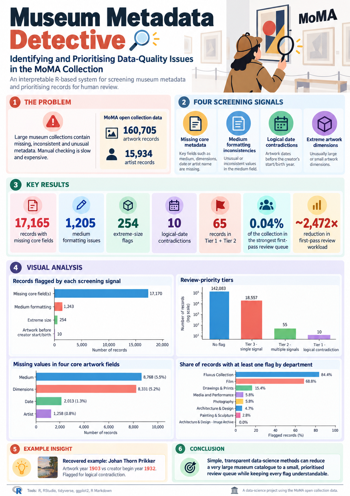

# Museum Metadata Detective

A simple R-based data science project that screens MoMA collection metadata for data-quality issues and prioritises records for human review.

  

## Project goal

Large museum collections can contain missing, inconsistent or unusual metadata.  
Manually checking every record is slow and expensive.

This project asks:

> Can simple, interpretable data-science methods reduce a large museum catalogue to a smaller and more useful review queue for human experts?

## Dataset

Source: Museum of Modern Art (MoMA) open collection data

- 160,705 artwork records
- 15,934 artist records

Official dataset:  
https://github.com/MuseumofModernArt/collection

## Methods

This project uses four simple screening signals:

1. Missing core metadata  
2. Medium formatting inconsistencies  
3. Logical date contradictions  
4. Extreme artwork dimensions  

These signals are combined into review-priority tiers.

## Main findings

- 17,165 records had at least one missing core field
- 1,205 records had medium formatting inconsistencies
- 254 records had extreme-size flags
- 10 records had strong logical date contradictions
- 65 records were placed in the top two priority tiers
- This strongest review queue represents only about 0.04% of the full collection

## Example insight

The system successfully recovered a known chronological inconsistency involving Johan Thorn Prikker, where the artwork year and creator year conflicted.

## Tools used

- R
- RStudio
- tidyverse
- ggplot2
- R Markdown

## Files

- `museum_metadata_analysis.Rmd` — full analysis code
- `museum_metadata_report.pdf` — written report

## Important note

A flag does not mean a record is definitely wrong.  
The goal is to support human review, not replace curatorial judgment.

## Future improvements

- validate flagged records manually
- standardise more metadata fields
- compare flagged review with random review
- test the framework on other museum datasets
- build a simple review dashboard
